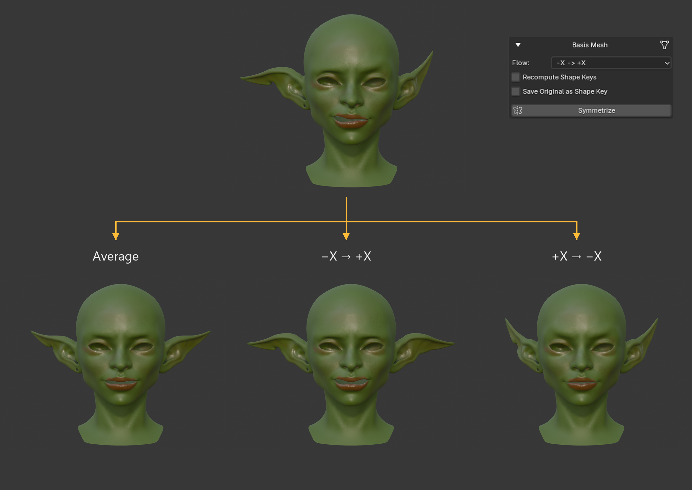
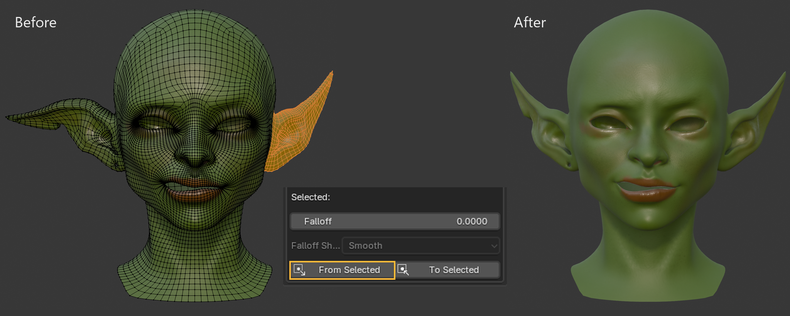
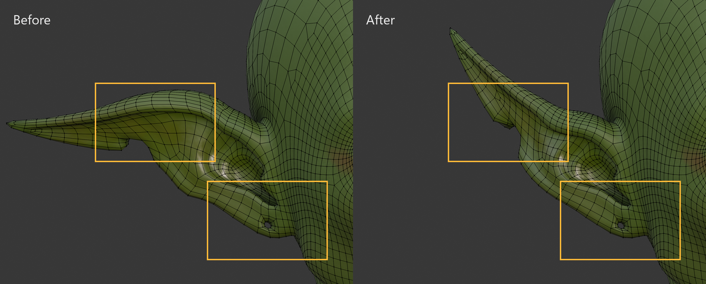

# Basis Mesh Symmetrization

Basis mesh symmetrization changes the actual vertex coordinates of the active mesh. It uses the mesh's persistent symmetry config to decide which vertices are paired and which vertices belong to the center line.

Before using this tool, make sure the active mesh has a valid config in **Persistent Symmetry Config**. The active mesh must have the same topology and vertex order as when the config was created.

## Where to Find It

In Blender, open the 3D View sidebar and go to:

`OmniMirror > Basis Mesh`

The section contains:

- **Flow**
- **Recompute Shape Keys**
- **Save Original as Shape Key**
- **Symmetrize**

## Parameters
### Flow

The **Flow** parameter controls how paired vertices are processed.

- `Average` finds the midpoint between each mirrored vertex pair and places both vertices symmetrically around the selected axis.
- `-X -> +X` copies vertex coordinates from the negative X side of the config to the positive X side. The axis letter changes to match the config's **Symmetry Axis**.
- `+X -> -X` copies vertex coordinates from the positive X side of the config to the negative X side. The axis letter changes to match the config's **Symmetry Axis**.



The directional flow is defined by the sides recorded when the config was created, not by the mesh's current visible position. Read the labels as the configured negative and positive axis sides, rather than assuming they always mean visual left and right.

```eval_rst
.. important::
    To avoid confusion, do not rotate the mesh unnecessarily after creating the config. If your character faces negative Y and the mirror axis is X, the usual interpretation is:
    - **-X -> +X** copies from the right side to the left side.
    - **+X -> -X** copies from the left side to the right side.

    For another orientation, follow the axis labels rather than visual left and right.
```

### Recompute Shape Keys

When **Recompute Shape Keys** is enabled, existing shape keys follow the change to Basis while keeping their deformation offsets.

### Save Original as Shape Key

Enable **Save Original as Shape Key** if you want to preserve the current mesh coordinates before symmetrizing.

When enabled, OmniMirror stores the previous coordinates in a shape key named `BEFORE_SYMMETRIZE`. Use it to compare the shapes or recover the previous one.

## Symmetrize Process

Click **Symmetrize** to apply the selected mode to the active mesh.

OmniMirror will:

1. Load the config stored on the active mesh.
2. Validate that the active mesh has a compatible vertex count.
3. Process all mirrored vertex pairs.
4. Force center vertices onto the selected symmetry axis.
5. Write the processed coordinates back to the basis mesh.

## Symmetrize a selection

In Edit Mode, select the vertices you want to use and open the **Selected** controls. **From Selected** copies their positions to their counterparts. **To Selected** copies the counterparts’ positions to the selection.

**Falloff** blends the change into nearby vertices along connected edges. The distance limits how far the effect reaches, and **Falloff Shape** sets the blend curve. A distance of zero disables it.



With **Use Laplacian** enabled in the config panel, unassigned vertices around a local asymmetry can follow the surrounding geometry. The ear’s hole and cut keep their topology as they move with the ear.


