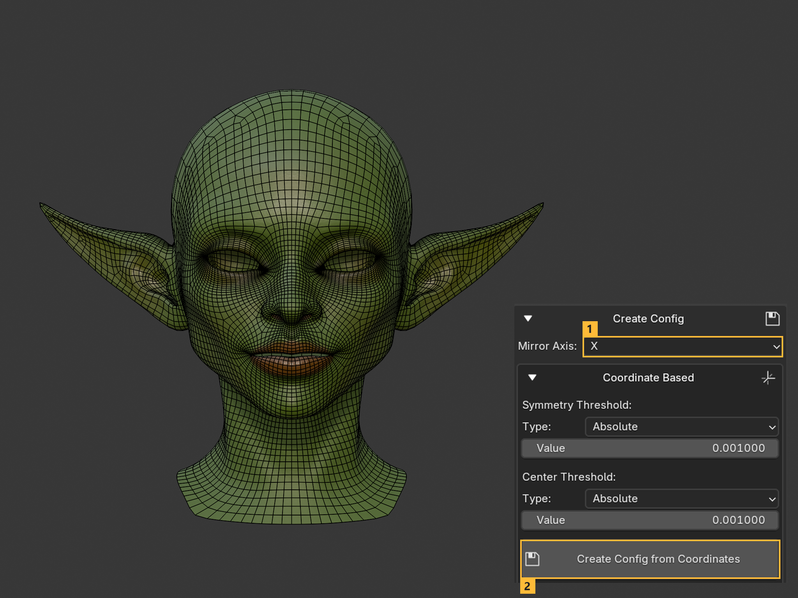
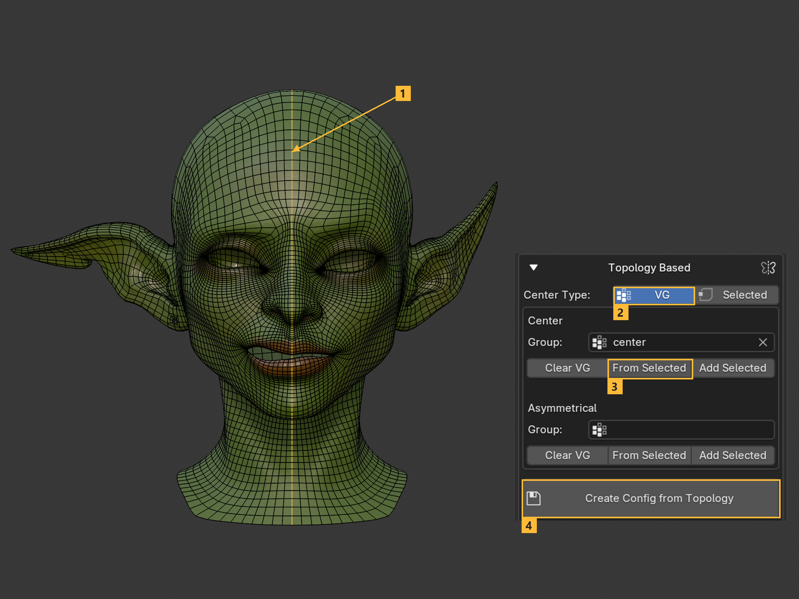
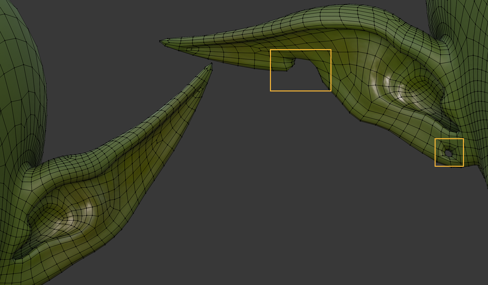
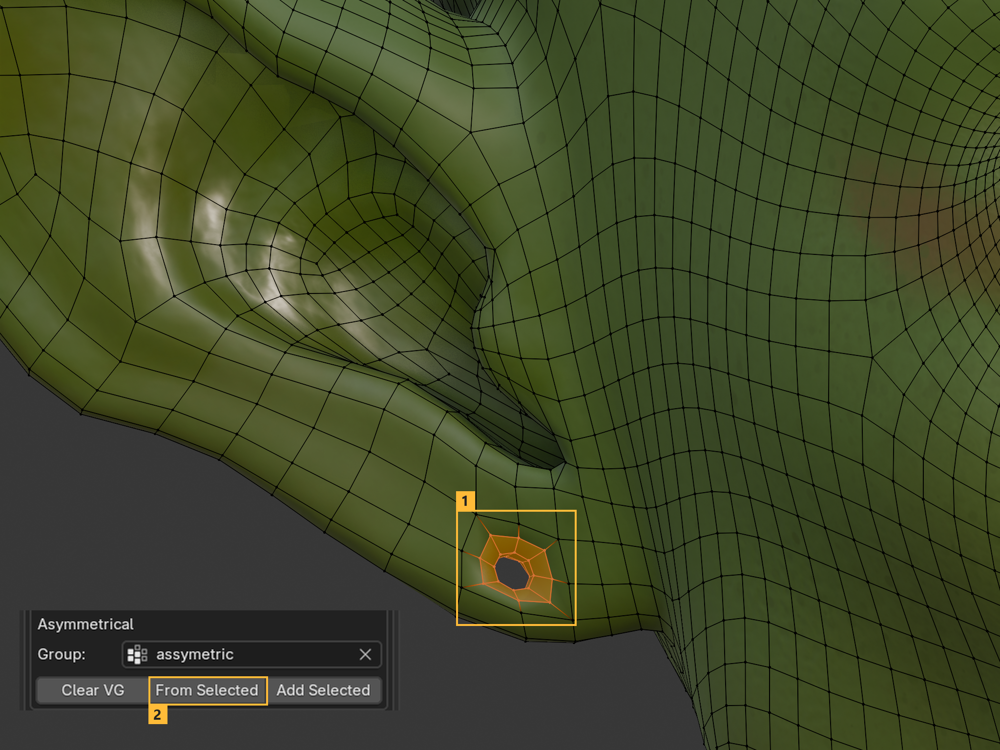
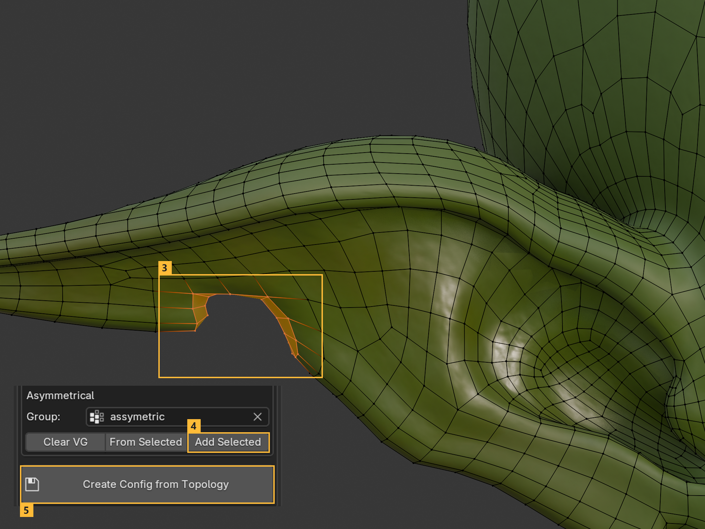
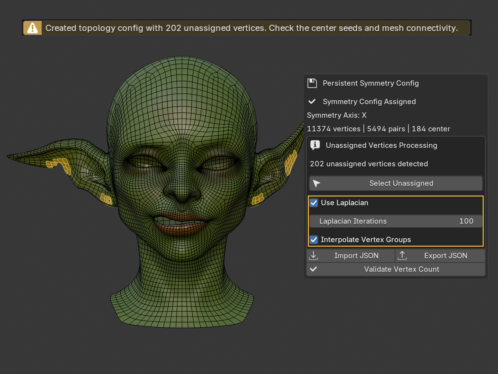
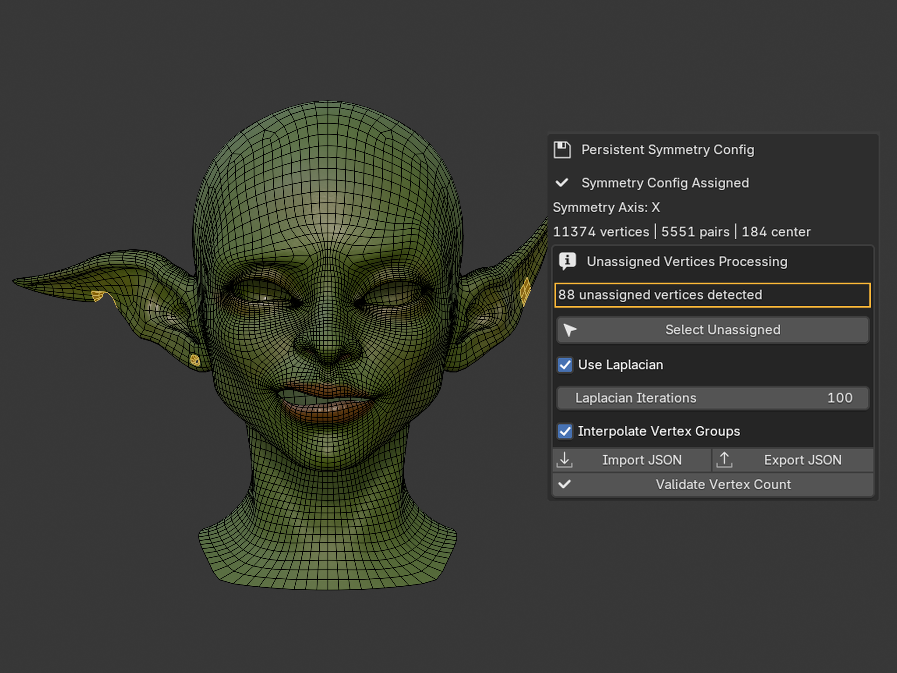

# Persistent Symmetry Config

A persistent symmetry config records which mesh vertices are paired across a mirror axis and which vertices belong to the center line. It lets OmniMirror use the symmetry that existed when the config was created, even after later edits make the mesh visually asymmetrical.

The config is stored on the mesh data in the `.blend` file. You do not need a JSON file for normal work in one project. Use **Export JSON** and **Import JSON** only to transfer a config between projects. You can also use **Copy to Selected** to assign the active mesh's config to selected compatible meshes in the same file.

## Where to Find It

In the 3D View sidebar, open:

`OmniMirror > Persistent Symmetry Config`

The panel reports whether a config is assigned, its **Symmetry Axis**, and its vertex, pair, and center counts. **Validate Vertex Count** checks whether the active mesh has the same vertex count as its stored config.

## Before You Create One

- Create the config before changing topology or vertex order.
- Coordinate-based detection works best on a genuinely symmetrical mesh, usually immediately after applying a Mirror modifier.
- Avoid duplicate vertices in coordinate-based detection: they can make an opposite-side match ambiguous.

After creation, you can move vertices, edit shape keys, paint weights, change UVs, and edit edge properties.

```eval_rst
.. warning::
    Keep the topology and vertex order unchanged. Adding, deleting, merging, splitting, remeshing, or reordering vertices requires a new config. An export and reimport can change vertex order even if the mesh looks the same.
```

## Create Config

Open **Create Config**, choose the **Mirror Axis**, then use either **Coordinate Based** or **Topology Based**.

### Coordinate Based

**Coordinate Based** finds a pair by reflecting a vertex across the chosen axis and looking for the best opposite-side match. Vertices close to the mirror plane become center vertices.



- **Symmetry Threshold** controls paired-vertex detection.
- **Center Threshold** controls center-vertex detection.
- Set each threshold **Type** to **Absolute** for an object-space distance or **Relative To Min Edge** for a percentage of the vertex's shortest connected edge. Relative is usually the safer default across different mesh scales.
- Click **Create Config from Coordinates** to save the config on the active mesh.

Use the **Troubleshooting Tools** before creating a final config:

- **Select Center** shows the vertices detected on the mirror plane.
- **Select Unassigned** shows vertices that cannot be paired or classified as center vertices.

If vertices are unassigned, adjust the thresholds, remove duplicates, or create the config earlier in the workflow. A config can retain unassigned vertices, but operations cannot mirror those vertices directly.

### Topology Based

**Topology Based** finds pairs by propagating through connected mesh topology from a known center. It does not use absolute vertex positions to find the pairs, so it can be useful when the mesh has small asymmetrical changes but its main connected structure is still symmetrical.

This is not intended to solve a completely asymmetrical character. It can help with partial asymmetry on an otherwise symmetrical mesh. It also cannot establish pairs for separate elements, such as independent left and right eye objects or disconnected eye islands: the pairing must propagate from the center through connected topology.

Choose how to define the center:

- **Selected** uses the center edges selected in Edit Mode. Select the edges, then click **Create Config from Topology**.
- **VG** uses the **Center** vertex group. Pick an existing group or select the center loops and click **From Selected** to create it. Then click **Create Config from Topology**.



#### Mark asymmetric regions

In **VG** mode, use the **Asymmetrical** vertex group to identify areas with no counterpart. This gives the topology search more information about where pairing should stop. On this head, one ear has a cut and a hole that the other ear does not have.



Select the vertices around the hole and use **From Selected** under **Asymmetrical**. Then select the cut and use **Add Selected** to add it to the same group. Create the topology config again with that group assigned.





## Unassigned vertices

When a config contains unassigned vertices, **Persistent Symmetry Config** shows their count under **Unassigned Vertices Processing**. In the example below, the panel reports **202 unassigned vertices detected**. Click **Select Unassigned** to inspect the affected areas.



- **Use Laplacian** blends unassigned regions into their processed surroundings for Basis Mesh, shape key symmetrization and splitting, and UV symmetrization.
- **Laplacian Iterations** sets the solver's maximum iteration count.
- **Interpolate Vertex Groups** fills unassigned weights from nearby assigned vertices along the mesh topology.

Use these options for local differences around a mesh with usable vertex pairs. For larger unresolved areas, check the center and the connectivity on both sides before continuing. In the ear example, marking the cut and hole reduces the unassigned count from 202 to 88 by helping the search resolve more of the surrounding mesh.



## Transfer a Config

- **Export JSON** writes the active mesh's config to a JSON file.
- **Import JSON** reads a compatible JSON config and stores it on the active mesh.
- **Copy to Selected** copies the active mesh's config to the other selected meshes. Those meshes must have a matching vertex count and compatible topology and vertex order.

JSON transfer does not remove the normal in-file storage: once imported, the config is again saved with the mesh in the `.blend` file.
