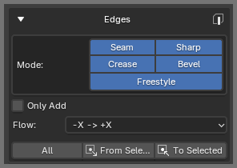

# Edge Symmetry

**Edges** copies edge properties using the active mesh's persistent symmetry config. Use **All** in Object Mode or Edit Mode. The selection tools are available in Edit Mode.

## Where to Find It

In the 3D View sidebar, open:

`OmniMirror > Edges`

## Symmetrize All

Under **Mode**, enable the properties to copy. The options are **Seam**, **Sharp**, **Crease**, **Bevel**, and **Freestyle**. Set **Flow**, then click **All**.

The flow uses the config's axis labels: **`-X -> +X`** copies from the negative axis side to the positive axis side, and **`+X -> -X`** copies in the other direction. The displayed axis changes to match the config, and the direction is defined by the sides recorded when that config was created.

Enable **Only Add** to keep marks that already exist on the target and to increase crease or bevel weights only when the source value is higher.

## Selected Edges

In Edit Mode, select the edges you want to use. **From Selected** copies the enabled properties to their counterparts. **To Selected** copies the enabled properties from each counterpart to the selected edge.

These actions use edge pairs whose endpoints have valid counterparts in the config. Blender’s **Edge** menu also has shortcuts for copying individual properties to or from symmetry.
